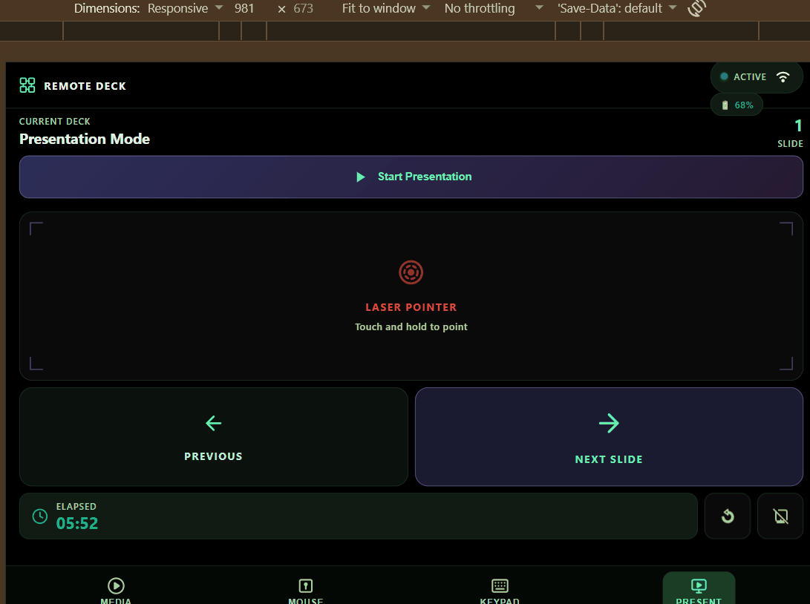
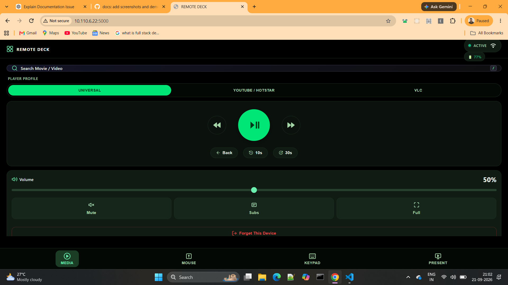
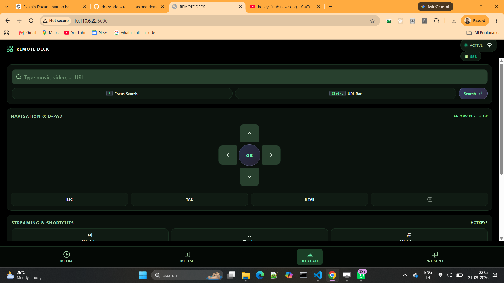
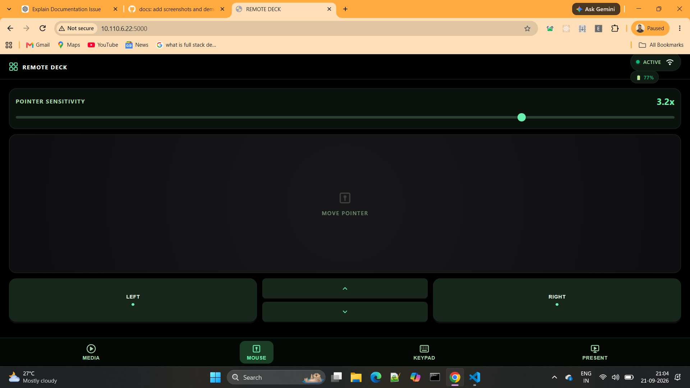
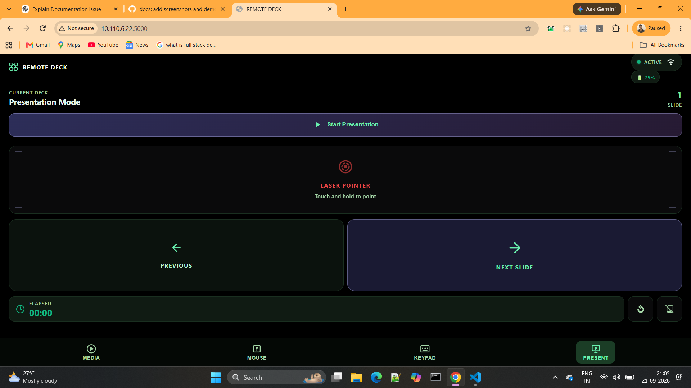
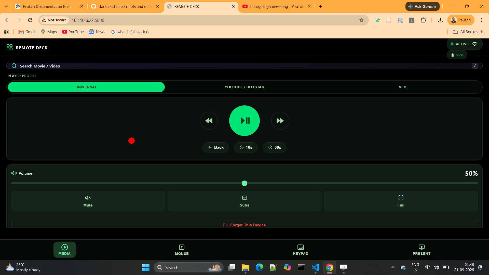
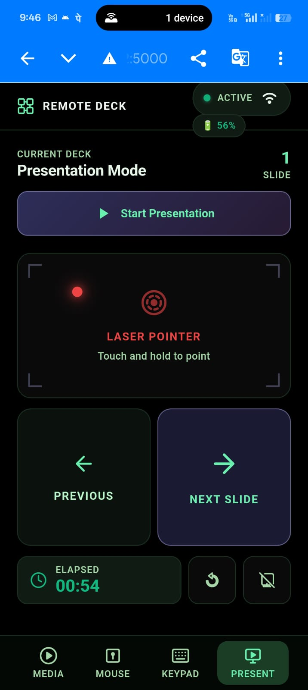

# 📱 Laptop Remote (Remote Deck)

[](https://github.com/Sathyabalan6/laptop-remote/actions/workflows/ci.yml)
[](https://pypi.org/project/laptop-remote/)
[](https://pypi.org/project/laptop-remote/)
[](LICENSE)
[](https://www.python.org/downloads/)
[](#-platform-support)

> Turn your smartphone into a powerful, low-latency remote control for your laptop. Control media playback, stream a high-precision trackpad, navigate with a virtual D-Pad and keyboard, and present with a real-time screen laser pointer.

<p align="center">
  
</p>

> ⚠️ **LAN-only tool.** Designed for trusted local networks (home Wi-Fi / hotspot). Do **not** expose it to the public internet — see [.github/SECURITY.md](.github/SECURITY.md).

---

## 📸 Screenshots

| Media Controls | Touch Trackpad | Virtual Mouse | Presentation Deck |
| :---: | :---: | :---: | :---: |
|  |  |  |  |

<details>
<summary><b>👀 View Real-World & Desktop Companion Preview</b></summary>
<br>

| Laptop Terminal Server | Phone Controlling Laptop |
| :---: | :---: |
|  |  |

</details>

---

## ✨ Features at a Glance

* **⚡ Terminal / Headless Edition**: A lightweight, no-GUI server that prints a QR code and pairing PIN directly in the terminal.
* **🌐 Zero-Config Discovery**: Connect instantly via QR code scan, local IP, or mDNS (`http://remotedeck.local:5000`).
* **🔒 Multi-Device PIN Pairing**: Protected with 6-digit rolling PIN verification, cryptographic session Bearer tokens, active device tracking, and per-device revocation.
* **🖱️ Precision Trackpad & 1-Thumb Scroll Rail**: Smooth cursor movement with DPI-scaled acceleration, tap-to-click, 2-finger pinch-to-zoom, and a dedicated right-edge scroll rail with 5ms tactile haptic ticks.
* **🎵 Nested Floating Media Deck**: Thumb-accessible playback controls (`-10s`, `Play/Pause`, `+10s`, `Mute`) directly on the trackpad, eliminating tab-switching friction.
* **⚡ Focus Mode (Smart App Sensing)**: Automatically senses active laptop applications (PowerPoint, Keynote, Google Slides, YouTube, VLC) and auto-switches your phone to the matching tab on the fly.
* **🎨 Apple HIG Glass & OLED Themes**: Translucent blur materials with high-contrast typography, safe-area insets, and an ultra-pure OLED Pitch Black theme.
* **⌨️ Keys Tab & System Macros**: Stream live text typing, navigate menus with a 5-way D-Pad, and trigger 1-touch macros (with double-tap safety confirmation on `Lock PC` and `Close Win`).
* **📊 Presentation Mode with Laser Pointer**: Projects a red laser dot over your laptop screen in real time, with asymmetric slide controls, blackout mode, interactive timer (tap to pause/resume), and tap-to-edit slide counter.
* **📱 Progressive Web App (PWA)**: Full offline precaching via service workers (`sw.js`) and installable to your phone's home screen.
* **🔋 Live Host Status**: Real-time laptop battery percentage, active profile, and volume status indicators.

---

## 🚀 Quick Start

### 1. Fastest Way: Zero-Install with `uv` (Recommended)

If you have [uv](https://docs.astral.sh/uv/) installed:

```bash
# Run immediately in 1 second (no installation, zero PATH issues):
uvx laptop-remote

# Or install permanently as a global CLI tool:
uv tool install laptop-remote
laptop-remote
```

> **Don't have `uv` yet?** Install it in one second:
> - **Linux / macOS**: `curl -LsSf https://astral.sh/uv/install.sh | sh`
> - **Windows**: `winget install astral-sh.uv` or in PowerShell: `powershell -c "irm https://astral.sh/uv/install.ps1 | iex"`

---

### 2. From Prebuilt Executable (Windows — No Python Needed)

1. Download **[`LaptopRemote-CLI.exe` from GitHub Releases](https://github.com/Sathyabalan6/laptop-remote/releases/latest)**.
2. Double-click `LaptopRemote-CLI.exe` (or run it in Command Prompt / PowerShell).
3. Connect your phone on the same Wi-Fi by scanning the printed QR code!

---

### 3. Via `pipx` or `pip` (Cross-Platform)

```bash
# Modern Linux (Ubuntu 23.04+, Debian 12+, Fedora, Arch) via pipx:
pipx install laptop-remote
laptop-remote

# Standard install on Windows or macOS:
pip install laptop-remote
laptop-remote

# If 'laptop-remote' is not recognized on Windows (Scripts folder not in PATH):
python -m laptop_remote
# or using Windows Python launcher:
py -m laptop_remote
```

---

### 3. From Source (Developers / Git Clone)

```bash
git clone https://github.com/Sathyabalan6/laptop-remote.git
cd laptop-remote

# Install in editable mode
pip install -e .

# Run with an auto-generated PIN and ASCII QR code
laptop-remote

# Run with a custom PIN or different port
laptop-remote --pin 123456 --port 5000

# Enable HTTPS/WSS (self-signed cert auto-generated)
laptop-remote --ssl
```

Linux users can also use the launcher script:
```bash
./scripts/run.sh
```

---

## 🛠️ Remote Deck Controls & Tabs

### 🖱️ 1. Trackpad Tab (Precision Mouse & Quick Deck)
* **High-Precision Trackpad**: Move cursor with one finger. Backed by native OS cursor calls (`win32api` / macOS Quartz / Linux Wayland & X11) with Per-Monitor DPI scaling for pixel-exact movement.
* **1-Thumb Right-Edge Scroll Rail**: Dedicated 44px vertical rail along the right edge: slide your thumb up/down to scroll with 5ms mechanical tactile haptic ticks.
* **2-Finger Pinch-to-Zoom**: Automatic gesture intent lock lets you pinch or spread two fingers to smoothly zoom web pages, maps, PDFs, and CAD drawings.
* **Nested Floating Media Deck**: Quick thumb-accessible playback bar (`⏪ -10s`, `⏯ Play/Pause`, `⏩ +10s`, `🔇 Mute`) directly on the trackpad.
* **Tap-to-Click & 2-Finger Right Click**: Tap with 1 finger to left click, tap with 2 fingers for tactile right click.
* **Tactile Click Buttons**: Dedicated Left Click, Lock, and Right Click buttons.
* **🔒 Tactile Drag Lock**: Dedicated toggle to keep the left mouse button held down for effortless window moving and text highlighting without finger gymnastics.
* **2-Finger Momentum Scroll**: Drag with two fingers to scroll web pages with smooth friction decay.
* **🎛️ Dual Sensitivity Popover**: Fine-tune both **Pointer Speed** and **Scroll Speed** directly from the trackpad pill.

---

### 🎵 2. Media Remote Tab (Playback & Audio)
* **Context-Aware Profiles**: Auto-detects or lets you manually switch between **YouTube / Hotstar**, **VLC Media Player**, and **Universal (Netflix / Prime / Web)** with descriptive sub-labels.
* **Tactile Playback Triad**: Play / Pause toggle, Skip Backward 10s (`⏪`), and Skip Forward 10s (`⏩`).
* **Direct Playback Rate Pills**: Instantly select discrete playback speeds (`0.75x` · `1.0x` · `1.25x` · `1.5x` · `2.0x`).
* **🔊 Synchronized OS Audio**: Continuous master volume slider with `-5%` / `+5%` tactile step buttons and instantaneous Mute toggle.
* **Navigation & View**: Subtitles (`CC`), Fullscreen toggle (`⛶`), Picture-in-Picture (`Miniplayer`), Theater mode, and Audio Track language cycling (VLC).

---

### ⌨️ 3. Keys Tab (D-Pad, Typing & Macros)
* **Live Typing & Search Dispatch**: Type text or URLs on your phone and press **Send** to stream keystrokes directly to the active text field on your laptop.
* **One-Touch Focus Pills**:
  * `/ Find`: Jumps directly to in-page search bars.
  * `Ctrl+L URL Bar`: Jumps focus to the browser's address bar.
* **Tactile 5-Way D-Pad**: Sized for thumb ergonomics (`Up`, `Down`, `Left`, `Right`, `OK / Enter`) with hold-to-repeat support for navigating menus, spreadsheets, and media lists.
* **Browser Navigation Keys**: Quick buttons for `◀ Back`, `Esc`, `Tab ⇥`, `⌫ Delete`, `⇧ Tab`, `Next Tab`, and `Reload`.
* **⚡ System Productivity Macros**:
  | Macro Button | Hotkey Action | Supported OS | Safety |
  | :--- | :--- | :--- | :--- |
  | **Copy** | `Ctrl+C` / `Cmd+C` | Windows, macOS, Linux | Instant |
  | **Paste** | `Ctrl+V` / `Cmd+V` | Windows, macOS, Linux | Instant |
  | **App Switch** | `Alt+Tab` / `Cmd+Tab` | Windows, macOS, Linux | Instant |
  | **Screenshot** | `Win+Shift+S` / `Cmd+Shift+4` | Windows, macOS, Linux | Instant |
  | **Close Window** | `Alt+F4` / `Cmd+W` | Windows, macOS, Linux | ⚠️ Double-tap confirm |
  | **Lock PC** | `Win+L` / `Ctrl+Cmd+Q` | Windows, macOS, Linux | ⚠️ Double-tap confirm |

---

### 📊 4. Presentation Deck & Laser Pointer Tab
* **Screen Laser Pointer**: Touch and drag your finger across the pad to project a smooth, hardware-rendered red laser dot over your laptop screen in real time.
* **Asymmetric Slide Navigation**: Giant **Next Slide (70%)** and **Prev Slide (30%)** buttons for confident, blind tactile control during speeches.
* **Auto-Start Presentation**: Mapped to `F5` (or `Ctrl+F5` when Google Slides, Canva, Prezi, or Docs are active).
* **Interactive Presentation Timer**: Built-in presentation stopwatch (`00:00`). Tap the timer to pause/resume (`⏸`/`▶`), double-tap to reset.
* **Tappable Slide Counter**: Tap the slide number anytime to set or resync your slide count if you skipped slides on the laptop.
* **Blackout Screen**: Blank the laptop display with one tap during presentations or breaks.
* **❓ Built-in Help Overlay**: Tap `(?)` in the top header anytime to view visual gesture cheat sheets, preset documentation, or replay the tutorial.

---

## 🔒 Security & Connection Details

* **Rolling One-Time PIN**: A fresh 6-digit PIN is generated upon startup and regenerated after each successful pairing or manual revocation.
* **Brute-Force Protection**: IP-based lockout triggers automatically after 5 consecutive incorrect PIN attempts (30-second escalating lockout).
* **Bearer Token Authorization**: Paired devices receive a cryptographically secure 48-character session token stored locally on your device.
* **Dual Transport**: High-frequency mouse coordinates and laser pointer positions stream over **WebSockets** for minimal latency, with automatic fallback to REST endpoints if required.
* **Offline Self-Contained**: Socket.IO client library and assets are fully bundled locally — **no internet connection or CDN required**.

---

## ⚙️ Configuration & Custom Presets

Key mappings are defined in [`presets.json`](presets.json). You can customize or add hotkeys for your favorite applications:

```json
{
  "youtube_hotstar": {
    "play_pause": "space",
    "skip_forward": "l",
    "skip_back": "j",
    "skip_forward_30": ["l", "l", "l"],
    "next": ["shift", "n"],
    "fullscreen": "f",
    "subtitles": "c",
    "speed_up": ["shift", "."]
  },
  "universal": {
    "play_pause": "space",
    "skip_forward": "right",
    "skip_back": "left",
    "fullscreen": "f"
  }
}
```

---

## 💻 Developer Setup & Building Executables

### Prerequisites
* Python 3.10+ installed and added to your system `PATH`.

### Running from Source
```bash
# Install the package in editable mode (pulls in all dependencies)
pip install -e .

# Run the server (terminal edition)
python -m laptop_remote
```

### Compiling a Standalone Executable (`.exe`)

* **Windows**: Double-click **`build.bat`** to build `dist/LaptopRemote-CLI.exe`.
* **Linux**: Run **`./build.sh`** to build `dist/LaptopRemote-CLI`.

---

## 📁 Project Structure

```
laptop-remote/
├── pyproject.toml              # Packaging metadata & dependencies
├── requirements.txt            # Runtime dependencies
├── presets.json                # Keyboard shortcut profiles (user-editable)
├── assets/                     # Visual branding assets
│   └── logo.ico                # App icon
├── scripts/                    # Launchers, builders & platform setup
│   ├── run.sh                  # Quick Linux launcher (auto-detects Wayland/X11)
│   ├── build.sh                # Linux PyInstaller standalone builder
│   ├── build.bat               # Windows PyInstaller standalone builder
│   ├── setup_linux.sh          # One-time Wayland (ydotool) permissions setup
│   └── laptop_remote_cli.spec  # Standalone binary PyInstaller spec
├── src/
│   └── laptop_remote/          # Main application package
│       ├── __init__.py
│       ├── __main__.py         # python -m laptop_remote
│       ├── server/             # Flask + SocketIO server package
│       │   ├── __init__.py     # public API (app, socketio, main)
│       │   ├── _app.py         # app construction & shared runtime state
│       │   ├── state.py        # build_state()
│       │   ├── routes_auth.py  # pairing, revoke, QR
│       │   ├── routes_input.py # mouse/key/text/pointer/volume
│       │   ├── websocket.py    # Socket.IO handlers
│       │   ├── discovery.py    # mDNS + preset monitor
│       │   └── main.py         # main() entry point
│       ├── cli.py              # Terminal/headless entry point
│       ├── core/               # Platform backends & utilities
│       │   ├── input.py        # Mouse/keyboard drivers (Windows/macOS/X11/Wayland)
│       │   ├── keys.py         # Key-name → Linux input-event keycode mapping
│       │   ├── logger.py       # Centralized logging configuration (--verbose/--quiet)
│       │   ├── auth.py         # PIN generation, bearer tokens, multi-device sessions
│       │   ├── config.py       # Presets JSON loader & storage
│       │   ├── device.py       # Friendly device naming
│       │   ├── network.py      # Local IP resolution & SSL certificate setup
│       │   ├── overlay.py      # Platform selection and Windows overlay
│       │   ├── overlay_x11.py  # Linux X11 SHAPE overlay
│       │   ├── power.py        # Battery status monitor
│       │   ├── window.py       # Foreground window detection & auto-preset
│       │   ├── audio.py        # Cross-platform volume control
│       │   └── tray.py         # System tray icon manager
│       └── static/             # Web frontend (served as the remote UI)
│           ├── index.html      # Single-page PWA application
│           ├── sw.js           # Service worker offline precaching
│           ├── css/            # tokens.css, base.css, components.css
│           └── js/             # app.js, transport.js, trackpad.js, presentation.js, ...
├── docs/                       # Architecture, roadmaps & research
│   ├── DOCUMENTATION.md        # Technical architecture & module deep-dive
│   ├── ROADMAP.md              # Planned milestones
│   ├── idea.md                 # System architecture overview
│   ├── research.md             # Shortcuts & streaming services reference
│   ├── archive/                # Completed milestone & audit history
│   └── images/                 # App preview screenshots & diagrams
├── tests/                      # pytest backend & vitest frontend test suites
└── README.md
```

---

## 🖥️ Platform Support

| Platform | Mouse / Keyboard | Presentation Laser Pointer |
|---|---|---|
| **Windows** | ✅ Native (`win32api`) | ✅ Red dot overlay |
| **macOS** | ✅ Native (`Quartz`) | ❌ Not yet |
| **Linux (X11)** | pyautogui / XTest | X11 SHAPE 1.1 overlay |
| **Linux (Wayland)** | ydotool / dotool; one-time scripts/setup_linux.sh | XWayland only when DISPLAY and SHAPE 1.1 are available |

> **Laser pointer note:** Windows uses its native Tk overlay. Linux uses an X11
> SHAPE 1.1 window with an empty input shape so mouse and touch events pass through.
> A direct Wayland session is not supported. XWayland availability depends on its
> display exposing SHAPE 1.1; if initialization fails, the app reports the pointer
> unavailable and keeps the laser pad hidden. macOS support is not yet implemented.

---

## 🧪 Running Tests
 
```bash
# Python backend tests (168 tests)
pip install -e ".[dev]"
pytest

# Frontend unit tests (49 Vitest tests)
npm install
npm test
```

Tests run automatically on Linux, Windows, and macOS via GitHub Actions.

---

## 🤝 Contributing

Contributions are very welcome! See [.github/CONTRIBUTING.md](.github/CONTRIBUTING.md) for setup
instructions, coding guidelines, and platform testing notes. Please also read our
[.github/CODE_OF_CONDUCT.md](.github/CODE_OF_CONDUCT.md).

- 🐛 [Report a bug](https://github.com/Sathyabalan6/laptop-remote/issues/new?template=bug_report.yml)
- ✨ [Request a feature](https://github.com/Sathyabalan6/laptop-remote/issues/new?template=feature_request.yml)
- 💬 [Ask a question](https://github.com/Sathyabalan6/laptop-remote/discussions)

---

## 🔐 Security

This is a **LAN-only** tool. Please read [.github/SECURITY.md](.github/SECURITY.md) before
reporting vulnerabilities or deploying it.

---

## 📄 License

This project is licensed under the **MIT License** — see [LICENSE](LICENSE).
Free to use, modify, and distribute for personal and commercial purposes.
